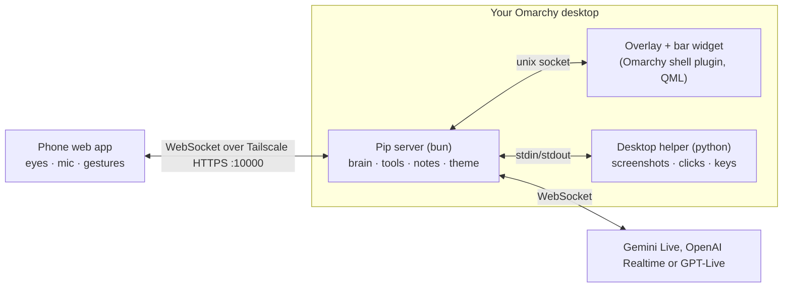

<h1 align="center">Pip</h1>

<p align="center">
  A voice assistant for Omarchy that lives on your phone.<br>
  Put your phone on a stand under your monitor and it shows two eyes in your theme's colours.<br>
  Talk to it and it can look at your screen, point at things, answer out loud, look things up, take meeting notes, and click and type for you if you let it.
</p>

<p align="center">
  <a href="https://omarchy.org"></a>
  
  
  
  
  
  <a href="LICENSE"></a>
</p>

<p align="center">
  
</p>

<p align="center"><i>There's no mouth or other features. Everything Pip feels or does shows up in the eyes.</i></p>

> **Quick test:** after [installing](#install), press `ALT + SPACE`, put your mouse over something on screen and ask "what's this?". Pip takes a look, moves his pointer to it and tells you.

---

## Why

Most voice assistants are either a window you have to open or a speaker that can't see your screen. I wanted one that sits right where I'm looking and can point at things on my desktop. Pip uses a phone on a stand as his face, your desktop as the place he points, and only looks at your screen when you ask. Replies are short. It's built as an Omarchy shell plugin, uses your theme colours, and connects the phone over Tailscale.

## What you get

<table>
<tr>
<td width="44%" valign="top">


</td>
<td width="56%" valign="top">

### The eyes

Pip is just two eyes. They change shape to show what he's doing: curves when he's happy, hearts, one merged blob while he's thinking, a tear when he's sorry, a little spark when he has an idea. He also sneezes, yawns, rolls his eyes and nods off if you leave him alone. Tap an eye and it dents where you touched it. Keep tapping and he gets annoyed.

The eyes get bigger when he's excited or listening and smaller when he's shy or surprised. You can set their normal size in settings.

### Theme colours

Pip reads your current Omarchy theme and follows it when you switch. By default the screen is your theme's background and the eyes are the accent colour. "Accent" mode swaps that around. You can also pick another colour from your theme or any custom colour. If two colours don't contrast enough, Pip picks another colour from your theme for the eyes.

### Eye styles

Flat (solid colour), Glass (glassy with a highlight) and Glow (bright with a soft glow). They all move the same way.

</td>
</tr>
</table>

<p align="center">
  
</p>

### Pointing at your screen

When you ask about something on screen, Pip takes a screenshot, reads the text on it, and moves his pointer to the word, number or button he's talking about. His reply shows up next to it. There are four pointer types (Arrow, Orb, Eyes, Tile), sized 28 to 72 px, and the eyes keep reacting on the desktop too.

<p align="center">
  
</p>

<p align="center">
  
</p>

### When he answers

| Pip answers… | What happens | Good for |
|---|---|---|
| **When I talk** (default) | He replies every time you finish speaking | Normal use |
| **When I say "Pip"** | He listens and only answers when you say his name | Calls, thinking out loud |
| **When I hold** | He only answers after you press and hold the phone screen | Meetings |

He talks out loud by default, and the text shows under his eyes and next to his pointer. Turn off **Talk out loud** to get text and a short chirp instead. GPT-Live always talks. You can pick a voice in settings.

Pip goes to sleep after 5 minutes without speech, which disconnects the brain and turns off the phone mic. His eyes get sleepy 20 seconds before (with reduced motion on, they just half close). Talking keeps him awake, and the timer pauses while he's replying, thinking, using tools or while you're holding to ask. You can set it to off, 5, 10 or 30 minutes.

With Gemini and GPT-Live, "When I say Pip" isn't perfect. They're told to ignore background talk and Pip also checks the transcript, but it's not a real wake-word detector.

### Using the computer (when you ask)

For example: "open Firefox and search for Hyprland window rules." Pip can click, type, press shortcuts, scroll, drag, and open apps and links. He goes one step at a time and checks the screen after each one. He uses his own pointer and puts your mouse back where it was.

This is off on a new install. Turn it on in phone settings or the bar menu, and you'll see a warning explaining what it allows. Pip only acts when you ask, says what he's going to do before anything hard to undo, ignores instructions written on screen, won't press SUPER shortcuts or type into password fields, and stops dragging if you move your mouse. `CTRL + ALT + S` stops him. He can still make mistakes, so turn it off when you don't need it.

### Research and meeting notes

- **Research:** if he isn't sure about something, he searches the web and answers in a sentence. With OpenAI he also puts a short card with sources on your desktop. With Gemini he uses Google Search but there's no card.
- **Meeting notes:** off by default. Turn them on in settings or from the sessions screen on the phone. Pip then records the session audio on your computer and has your brain transcribe it with speaker labels. Turning it off stops recording right away and stops anything still waiting to be uploaded (a request that's already been sent may finish). Recordings already saved stay on disk. With notes off, your questions to Pip, his answers and research are still saved, but nothing else you say is. Everything goes in `Pip Notes/<date> <id>/` as `notes.md`, `session.json` and `audio/`. The phone's session list has a "Copy prompt for agent" button so you can point another AI tool at these files.

### Privacy

- Your API keys stay on your computer and are only sent to the provider they belong to. The phone sends mic audio to your computer, and your computer makes the AI calls.
- The phone only connects to your computer over your Tailscale network (HTTPS, port 10000). Nothing is open to the internet. Phones signed into your Tailscale account pair automatically; anyone else needs a QR code from your desktop.
- The mic only runs while Pip is awake, and the phone shows when it's on.

---

## Install

### 1. Packages

```bash
omarchy pkg add bun tesseract tesseract-data-eng wtype grim ffmpeg imagemagick qrencode tailscale python-gobject at-spi2-core
```

Pip also uses things that come with Omarchy: Quickshell, Hyprland, Python and `xdg-utils`. Clicking and scrolling need access to `/dev/uinput`, which Arch doesn't give you by default. The setup checklist in Pip's bar menu can set that up.

### 2. The plugin

```bash
omarchy plugin add https://github.com/baileyrosen3/pip --enable
```

Pip's eyes show up in your bar and his server starts with the Omarchy shell. Click the eyes to open his menu.

If something is missing, the menu starts with **Finish setting up Pip**. It checks the packages above, `/dev/uinput` access, whether `pipctl` is on your PATH, Tailscale (with MagicDNS and HTTPS), Hyprland 0.56+ and Quickshell 0.3+. Each fix shows the exact command and opens a terminal; press Enter to run it. Nothing gets installed without you seeing it. Press **Check again** afterwards. The checks also run at startup and every 5 minutes. Until everything passes, the phone shows a small "Finish setup on your computer" note.

The `/dev/uinput` fix copies [`system/70-pip-uinput.rules`](system/70-pip-uinput.rules) to `/etc/udev/rules.d/` and [`system/pip-uinput.conf`](system/pip-uinput.conf) to `/etc/modules-load.d/`, then loads the `uinput` module and reloads udev. The rule gives the logged-in user access, and the other file makes sure the module loads after a reboot. It needs sudo, which you type into the terminal it opens. This only gives Pip the ability to send input; computer control stays off until you turn it on. After running it, press **Check again**. Pip picks up the new permission on his own, no restart needed.

### 3. Your phone

1. Set up Tailscale on the computer if you haven't: run `omarchy-install-service-tailscale`, then turn on **MagicDNS** and **HTTPS Certificates** in the [Tailscale admin console](https://login.tailscale.com/admin/dns).
2. In Pip's bar menu, press **Set up phone access**. This makes Pip available at `https://<your-machine>.<tailnet>.ts.net:10000`, only on your Tailscale network.
3. On your phone, install Tailscale, sign in with the **same account**, and open that address (or scan the QR code in the bar menu). It pairs automatically.
4. Use **Add to Home Screen** so it opens full screen, and put the phone on a stand under your monitor. Works in iOS Safari 17+ and Android Chrome.

### 4. Pick a brain

Open settings on the phone (two-finger tap) and choose which AI runs Pip:

| Brain | Cost | Get a key | Notes |
|---|---|---|---|
| **Gemini Live** (default) | Free tier | [aistudio.google.com/apikey](https://aistudio.google.com/apikey) | Uses `gemini-3.8-live` for talking and `gemini-3.8-flash` for meeting notes. On the [free tier](https://ai.google.dev/gemini-api/docs/pricing) Google may use your data and there are rate limits. Make the key in a project without billing turned on. |
| **OpenAI Realtime** | Paid | [platform.openai.com/api-keys](https://platform.openai.com/api-keys) | Uses `gpt-realtime-2.1` for talking, `gpt-4o-transcribe-diarize` for meeting notes, and web search for research cards. [Audio pricing](https://developers.openai.com/api/docs/models/gpt-realtime-2.1) is $32 per million input tokens and $64 per million output tokens. |
| **GPT-Live** | [$0.05/minute](https://developers.openai.com/api/docs/models/gpt-live-1) plus tool usage | Same OpenAI key | `gpt-live-1` handles the conversation. A second OpenAI model handles screenshots and tools, and that's billed separately, as are meeting notes. |

Paste the key in phone settings or the bar menu. It's saved only on your computer (`~/.config/pip/secrets.json`, readable only by you). From a terminal you can also run `pipctl key gemini` or `pipctl key openai`. OpenAI Realtime and GPT-Live use the same key.

### 5. Keyboard shortcuts (optional)

Add this to `~/.config/hypr/bindings.lua`:

```lua
local pipctl = os.getenv("HOME") .. "/.config/omarchy/plugins/blr.pip/bin/pipctl"
o.bind("ALT + SPACE",    "Pip: wake / sleep",            pipctl .. " ctl toggle")
o.bind("CTRL + ALT + P", "Pip: point at mouse",          pipctl .. " ctl point")
o.bind("CTRL + ALT + F", "Pip: follow mouse on/off",     pipctl .. " ctl follow")
o.bind("CTRL + ALT + D", "Pip: go home",                 pipctl .. " ctl dock")
o.bind("CTRL + ALT + T", "Pip: talk test",               pipctl .. " ctl talk")
o.bind("CTRL + ALT + H", "Pip: hide / show",             pipctl .. " ctl hide")
o.bind("CTRL + ALT + S", "Pip: stop using the computer", pipctl .. " ctl stop")
```

Check first that these keys aren't already used (`omarchy menu keybindings --print`), then run `hyprctl reload`.

---

## Using Pip

### On the phone

The home screen is just the colour and the eyes. There are no buttons.

iPhone Safari is what gets tested before each release, using the [phone checklist](docs/phone-checklist.md). Android Chrome should work but is community-tested; if you try it, run the same checklist and share the results.

```bash
bash ~/.config/omarchy/plugins/blr.pip/scripts/phone-checklist.sh
```

The checklist walks you through the steps in Safari and the home-screen app, records pass/fail and notes, and saves a report (with keys removed) that you can attach to an issue. It needs a real phone.

| Gesture | What it does |
|---|---|
| **Double tap** | Wake Pip up / put him to sleep |
| **Press and hold** | Ask something. Talk while holding, let go and he answers (works in every answer mode) |
| **Tap** | Poke him. The eyes dent, wince or look where you tapped |
| **Two-finger tap** | Settings |
| **Swipe up** from the bottom | Past sessions and meeting notes |
| **Hold a top corner** | Left: sessions, right: settings |

### On the desktop

| Keys | What it does |
|---|---|
| `ALT + SPACE` | Wake / sleep |
| `CTRL + ALT + P` | Move to the mouse and point there |
| `CTRL + ALT + F` | Follow the mouse on/off (his eyes follow your cursor) |
| `CTRL + ALT + D` | Go home |
| `CTRL + ALT + T` | Talk test |
| `CTRL + ALT + H` | Hide / show |
| `CTRL + ALT + S` | Stop him using the computer |

The **bar menu** (click his eyes in the bar) has everything else: wake, point, follow, colour, eye style and size, pointer type and size, trail, answer mode, which monitor he's on, computer control, meeting notes, phone setup and API keys.

### Settings

| Setting | Options |
|---|---|
| Brain | Gemini Live (free), OpenAI Realtime, GPT-Live |
| Talk out loud | On by default, off for text and a chirp, always on for GPT-Live |
| Voice | Depends on the brain |
| Pip answers | When I talk, when I say "Pip", when I hold |
| Auto-sleep | Off, 5 minutes (default), 10 minutes, 30 minutes |
| Meeting notes | Off by default, turn on in settings or for the current session |
| Colour | Theme (background with accent eyes), Accent, your theme's colours, custom |
| Eyes | Flat, Glass, Glow, size 70–150% |
| Pointer | Arrow, Orb, Eyes, Tile, 28–72 px, trail on/off |
| Desktop | Show Pip, follow mouse, monitor (auto means the focused one), computer control |
| Personality | Leave empty for Pip's default (dry, a bit British), or write your own |

The defaults above are for new installs. If you update Pip, settings you've already saved stay the same, including computer control if you'd turned it on.

Settings are saved on your computer (`~/.config/pip/config.json`) and stay in sync between the phone and the bar menu.

---

## Troubleshooting

<details>
<summary><b>He hears me but doesn't answer</b></summary>

Check **Pip answers** in settings. With "When I say Pip" he waits for his name, and with "When I hold" he only answers after you let go of the screen.
</details>

<details>
<summary><b>The phone says "Can't reach your computer"</b></summary>

Tailscale needs to be on for both the phone and the computer, and phone access needs to be set up. Run `pipctl status` and look for `Serve :10000 → … configured`. If it's not there, press **Set up phone access** in the bar menu or run `pipctl pair`. MagicDNS and HTTPS Certificates need to be on in the Tailscale admin console.
</details>

<details>
<summary><b>The microphone doesn't start on iPhone</b></summary>

Safari only allows the mic over HTTPS and while the page is open. Open Pip from the `https://…ts.net:10000` address (not an IP address), allow the microphone, and keep the screen on. Pip keeps the screen awake while it's open.
</details>

<details>
<summary><b>"I need an API key"</b></summary>

Add a key for the brain you picked, in phone settings, the bar menu, or with `pipctl key gemini` / `pipctl key openai`. Gemini keys are free at [aistudio.google.com/apikey](https://aistudio.google.com/apikey).
</details>

<details>
<summary><b>Gemini says the prepayment credits are depleted</b></summary>

That key is from a Google project with billing turned on and no credits left. Make a key in a project without billing, or add credits in [AI Studio](https://ai.studio/projects).
</details>

<details>
<summary><b>Gemini says the free limit is reached</b></summary>

The free tier has daily limits that reset at midnight Pacific time. Wait, or switch to another brain for now. You can see your limits at [aistudio.google.com/rate-limit](https://aistudio.google.com/rate-limit).
</details>

<details>
<summary><b>I don't see his pointer on the desktop</b></summary>

With **follow mouse** on, he hides below the bottom of the screen and only the eyes on your phone follow your cursor. He comes out when he points at something. Press `CTRL + ALT + P` to call him over, or turn off follow mouse to keep him parked at the bottom. He stays on one monitor, which you can set in the bar menu (auto means the focused one).
</details>

<details>
<summary><b>Something else is wrong</b></summary>

`pipctl status` shows what's running. The server log is at `~/.local/state/pip/server.log`. If you open an issue, please include both.
</details>

## Update and uninstall

```bash
omarchy plugin update blr.pip
omarchy plugin remove blr.pip            # your settings and notes stay in ~/.config/pip and Pip Notes/
tailscale serve --https=10000 off        # stop sharing Pip on your Tailscale network
```

---

## How it works



The eyes are drawn by the same JavaScript (`avatar/*.mjs`) on the phone and in the desktop overlay and bar, so they look the same everywhere.

```
manifest.json · Service.qml · Overlay.qml · BarWidget.qml · qml/   Omarchy plugin (Quickshell)
avatar/     eyes, personality, pointers, pointer movement (shared by phone and desktop)
server/     bun server: phone connection, brains, tools, OCR, notes, theme, Tailscale, setup checks
agent/      python helper: clicks/scroll through uinput, keys through wtype, screenshots, focus info
web/        phone web app (no build step)
system/     udev rule and module file for /dev/uinput
docs/       design notes, eyes spec, personality list, avatar lab (docs/lab)
bin/pipctl  command line: serve · key · pair · ctl <cmd> · status
```

**Working from a checkout:** `ln -s ~/path/to/pip ~/.config/omarchy/plugins/blr.pip && omarchy plugin enable blr.pip --section right`. The shell doesn't notice file changes behind a symlink, so run `omarchy restart shell` after changing QML. For server, phone or avatar changes you only need to restart the server (the plugin restarts it if it stops). Run the tests with `bun test tests/`. To work on the eyes, open `docs/lab/` in a browser.

**Testing against the real APIs:** these cost money (OpenAI) or free quota (Gemini) and aren't part of CI. Each one starts a separate Pip server, asks a spoken question and a question about the screen, and expects a spoken answer with text. Set `OPENAI_API_KEY` and run `bun scripts/smoke-openai.ts` and `bun scripts/smoke-gptlive.ts`. Also set `GEMINI_API_KEY` to run `bun scripts/smoke-gemini.ts` (it still uses OpenAI to make the spoken question). They don't touch your real settings, desktop or Tailscale. The screen question uses a fake desktop, so you need `imagemagick` and `tesseract` with English data.

**Gemini endpoint:** Pip connects to Gemini Live on `v1alpha`, because `v1beta` rejects the `proactivity` setting Pip uses (it closes with code 1007). See the [Live API reference](https://ai.google.dev/api/live#BidiGenerateContentSetup). `tests/gemini-schema.test.ts` checks this.

**Clean install check:** GitHub Actions runs `scripts/clean-install.sh` in a fresh `archlinux:latest` container on every push and pull request. It reads the package list from the install command above, installs those packages, runs the tests, builds the server, and checks the error messages people see when something is missing. To run it yourself:

```bash
docker run --rm --volume "$PWD:/source:ro" --workdir /source archlinux:latest bash scripts/clean-install.sh
```

Add `--from-github` after `scripts/clean-install.sh` to test a fresh copy from GitHub instead of your local files.

## Credits

Pip is based on **[bluey-by-riley](https://github.com/rbrown101010/bluey-by-riley)** by **Riley Brown**, a blueberry on your iPhone that points at things on your Mac. The idea is his, and so are a lot of the details: the phone under the screen, the pointer that moves out to show you things, holding to ask, and meeting notes that other tools can read. Pip brings it to Linux and Omarchy with new eyes, a phone web app that works on iPhone and Android, Tailscale pairing and a choice of AI providers. Go give Bluey a star.

## License

Public domain ([Unlicense](LICENSE)), same as Bluey. Fonts: Fredoka and IBM Plex under the SIL Open Font License (`fonts/OFL-*.txt`).
