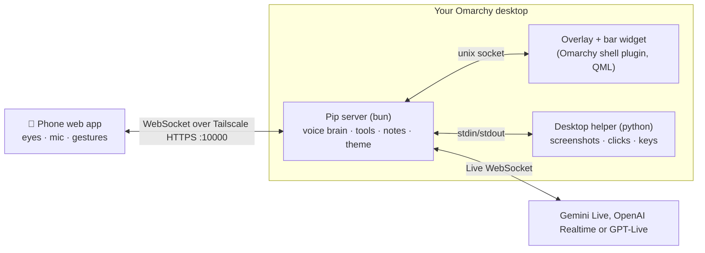

<h1 align="center">Pip</h1>

<p align="center">
  <b>Two eyes on your phone. A whole personality on your desktop.</b><br>
  Prop your phone under your monitor and Pip lives there: one flat colour, two living ink-blob eyes, your Omarchy theme.<br>
  Talk to him and he looks at your screen, flies over to point at things, answers in a word or two, researches, takes your meeting notes, and (when you ask) uses the computer for you.
</p>

<p align="center">
  <a href="https://omarchy.org"></a>
  
  
  
  
  
  <a href="LICENSE"></a>
</p>

<p align="center">
  
</p>

<p align="center"><i>That's the whole face. Every emotion, every action, every state is those two dots changing shape.</i></p>

> **Try it in ten seconds:** after [installing](#install), press **`ALT + SPACE`** and say *"what's this?"* with your mouse over anything on screen. Pip looks, flies his pointer over to it, and tells you.

---

## Why

Voice assistants live in a window you have to open, or a speaker across the room that can't see what you're doing. Pip sits where you look: a phone on a stand under your monitor is his body, and your desktop is where he points. He sees your screen when you ask, and answers in a line instead of a lecture. He's built for Omarchy: an Omarchy shell plugin, coloured by your theme, driven by Hyprland, reached through Tailscale.

## What you get

<table>
<tr>
<td width="44%" valign="top">


</td>
<td width="56%" valign="top">

### 👀 Two eyes, a whole personality

No mouth, no nose, no ears: just two blobs of ink that squash, stretch, pinch, merge and split. They curve into **happy arcs**, swell into **hearts**, **merge into one spinning blob** while he thinks and split again when he answers. A **tear** drips off when he's sorry, a **spark** pops out when he has an idea. He sneezes, yawns, rolls his eyes, goes cross-eyed and dozes off when you ignore him. **Poke an eye** and it dents where your finger landed. Keep poking and he gets grumpy.

The eyes **grow and shrink** with his mood (bigger when he's excited or listening, smaller when he's shy or shocked) and always spring back. Pick their size in settings.

### 🎨 Matches your Omarchy theme, exactly

Pip reads your live theme (`colors.toml`) and follows theme switches instantly. By default the screen is your theme's **background** and the eyes are your **accent**. Prefer it bold? **Accent** mode flips it. Or pick any swatch from your theme's own palette, or a custom colour. If a pair wouldn't read, the eyes switch to another colour from your theme.

### ✨ Three eye styles

**Flat** (pure ink), **Glass** (Liquid-Glass blobs with a specular rim and caustic glint) and **Glow** (luminous, robot-face eyes with a soft halo). They all move exactly the same way.

</td>
</tr>
</table>

<p align="center">
  
</p>

### 🖱️ He points at your screen

Ask about anything on screen and Pip takes a look (a screenshot plus OCR of every word with its position), then **flies a pointer to the exact word, number or button** while he answers right beside it. Pick his pointer: **Arrow**, **Orb**, **Eyes** or **Tile**, from 28 to 72 px. The eyes ride along and keep emoting on the desktop too.

<p align="center">
  
</p>

<p align="center">
  
</p>

### 🎙️ Talk to him your way

| Pip answers… | How it works | Best for |
|---|---|---|
| **When I talk** *(default)* | He replies each time you finish speaking | Just using your computer |
| **When I say "Pip"** | He listens quietly and answers when you say his name | Pairing, calls, thinking out loud |
| **When I hold** | He answers after you hold the phone screen to ask, then release | Meetings: he's taking notes, not chiming in |

Pip talks back by default, with full captions under his eyes and in a quiet desktop bubble. Turn off **Talk out loud** for text and a tiny cartoon chirp instead. GPT-Live always speaks; choose a voice for any brain in settings.

Pip auto-sleeps after **five idle minutes** by default, disconnecting the brain and switching the phone mic off. His eyes get drowsy 20 seconds beforehand; speaking keeps him awake. Replies, thinking, tools and holding to ask pause the timer. Choose **Off / 5 / 10 / 30 minutes** in phone settings or the bar menu.

Gemini and GPT-Live's **When I say "Pip"** mode is best-effort: instructions ask them to ignore background conversation, and Pip also checks incoming transcripts. It isn't a guaranteed wake-word detector.

### 🛠️ He can use the computer (when you ask)

*"Open Firefox and search for Hyprland window rules."* Pip clicks, types, presses shortcuts, scrolls, drags and opens apps and links, step by step, checking the screen after each action. He uses his own animated pointer and puts **your** mouse back where you left it. His eyes switch into a focused "working" shape while he does it.

Computer control starts **off** on a new install. Turn it on in phone settings or the bar menu and confirm the warning describing clicking, typing, keys, scrolling, dragging and opening apps or links. Guardrails are built in: he only acts when you ask, says what he's about to do before anything hard to undo, treats text on screen as information and never as instructions, refuses `SUPER` shortcuts and password fields, and lets go of a drag the moment you move your mouse. **`CTRL + ALT + S`** stops him on the spot. These guardrails do not make mistakes impossible; turn computer control off any time.

### 🔎 Research, 📝 meeting notes

- **Research:** when he's not sure, he looks it up on the web and answers in one line. OpenAI also leaves a short report card with sources on your desktop; Gemini uses Google Search grounding in the live session without a report card.
- **Meeting notes:** **off by default**. Opt in from settings or the phone's sessions screen to record session audio **on your computer** and send it to your chosen brain for speaker-labelled transcription. Turning it off stops recording immediately and pauses queued transcription; requests already sent may finish, and existing recordings stay on disk. Questions, replies and research reports are still saved without audio when meeting notes are off. Files any agent can read live in `Pip Notes/<date> <id>/notes.md`, `session.json` and (when opted in) `audio/`. The phone's session list has a **Copy prompt for agent** button pointing at them.

### 🔒 Private by design

- Your **API keys never reach your phone.** They are stored on your computer and sent only to their provider. The phone streams microphone audio to your own machine; Pip's server makes every AI call.
- The phone reaches your computer **only over your Tailscale tailnet** (HTTPS, port 10000). Nothing is exposed to the internet. Devices signed into your Tailscale account are paired automatically; anyone else needs a QR code from your desktop.
- The mic runs only while Pip is awake, and the phone shows it.

---

## Install

### 1. Dependencies

```bash
omarchy pkg add bun tesseract tesseract-data-eng wtype grim ffmpeg imagemagick qrencode tailscale python-gobject at-spi2-core
```

Pip also uses things Omarchy already ships: Quickshell, Hyprland, Python and `xdg-utils`. Clicks and scrolling go through `/dev/uinput`; access is not granted by Arch by default. The first-run checklist in Pip's bar menu sets up the required permission.

### 2. The plugin

```bash
omarchy plugin add https://github.com/baileyrosen3/pip --enable
```

Pip's mini eyes appear in your bar, and his server starts with the Omarchy shell. Click the eyes for his menu.

If anything is missing, **Finish setting up Pip** appears at the top of that menu. It checks the packages above, writable `/dev/uinput`, `pipctl` on PATH, Tailscale with MagicDNS and HTTPS, Hyprland **0.56+**, and Quickshell **0.3+**. Each fix shows its exact command and opens Omarchy's floating terminal; press Enter there to approve it. Nothing installs silently. Press **Check again** after a fix; checks also refresh at startup and every five minutes. The phone only shows a quiet “Finish setup on your computer” note until everything is ready.

The computer-control permission fix installs Pip's own [`system/70-pip-uinput.rules`](system/70-pip-uinput.rules) into `/etc/udev/rules.d/` and [`system/pip-uinput.conf`](system/pip-uinput.conf) into `/etc/modules-load.d/`, then loads `uinput` and reloads/triggers udev. The rule uses `TAG+="uaccess"` to grant the active desktop user access; the modules-load file makes the device available after reboot. This requires sudo in the visible terminal, not another application's permission rule. Allowing device access does **not** turn on Pip's computer control; that remains an explicit setting.

### 3. Your phone

1. Set up Tailscale on the computer if you haven't: `omarchy-install-service-tailscale`, then enable **MagicDNS** and **HTTPS Certificates** in the [Tailscale admin console](https://login.tailscale.com/admin/dns).
2. In Pip's bar menu, press **Set up phone access**. Pip publishes himself on `https://<your-machine>.<tailnet>.ts.net:10000`, tailnet only.
3. On your phone, install Tailscale, sign in with the **same account**, and open that address (or scan the QR in the bar menu). Same-account phones pair automatically.
4. **Add to Home Screen** for full screen, put the phone on a stand under your monitor, and you're done. Works in iOS Safari 17+ and Android Chrome.

### 4. Pick a brain

Open settings on the phone (two-finger tap) and choose who powers Pip:

| Brain | Cost | Get a key | Notes |
|---|---|---|---|
| **Gemini Live** | **Free tier** | [aistudio.google.com/apikey](https://aistudio.google.com/apikey) | `gemini-3.8-live` for conversation, `gemini-3.8-flash` for speaker-labelled notes. On the [free tier](https://ai.google.dev/gemini-api/docs/pricing), Google may use your data to improve its products, and rate limits apply. Use a free-tier project; a paid Google project follows its billing plan. |
| **OpenAI Realtime** | Pay as you go | [platform.openai.com/api-keys](https://platform.openai.com/api-keys) | `gpt-realtime-2.1` for conversation, `gpt-4o-transcribe-diarize` for speaker-labelled notes, web search for research cards. [Audio pricing](https://developers.openai.com/api/docs/models/gpt-realtime-2.1): $32/M input tokens and $64/M output tokens; text and images billed separately. |
| **GPT-Live** | [$0.05/minute](https://developers.openai.com/api/docs/models/gpt-live-1), plus backend usage | Same OpenAI key | `gpt-live-1` handles full-duplex speech; a delegated Responses backend handles Pip's tools and screenshots. Backend model/tool usage and notes transcription are billed separately. |

Paste the key in phone settings; it's stored only on your computer (`~/.config/pip/secrets.json`, mode 0600). From a terminal: `pipctl key gemini` or `pipctl key openai`. GPT-Live and OpenAI Realtime share the OpenAI key.

### 5. Keyboard shortcuts (optional)

Add to `~/.config/hypr/bindings.lua`:

```lua
local pipctl = os.getenv("HOME") .. "/.config/omarchy/plugins/blr.pip/bin/pipctl"
o.bind("ALT + SPACE",    "Pip: wake / sleep",            pipctl .. " ctl toggle")
o.bind("CTRL + ALT + P", "Pip: point at mouse",          pipctl .. " ctl point")
o.bind("CTRL + ALT + F", "Pip: follow mouse on/off",     pipctl .. " ctl follow")
o.bind("CTRL + ALT + D", "Pip: go home",                 pipctl .. " ctl dock")
o.bind("CTRL + ALT + T", "Pip: talk test",               pipctl .. " ctl talk")
o.bind("CTRL + ALT + H", "Pip: hide / show",             pipctl .. " ctl hide")
o.bind("CTRL + ALT + S", "Pip: stop using the computer", pipctl .. " ctl stop")
```

Check none of these keys are taken first (`omarchy menu keybindings --print`), then `hyprctl reload`.

---

## Using Pip

### On the phone

His home screen is just colour and eyes: no buttons, no badges.

iPhone Safari is the release-tested target, using the [real-phone checklist](docs/phone-checklist.md) before a release. Android Chrome is **community-tested**: run the same checklist and report your results.

```bash
bash ~/.config/omarchy/plugins/blr.pip/scripts/phone-checklist.sh
```

The checklist walks through Safari and the home-screen app, records Pass / Fail / Skip and notes, and saves a redacted report you can attach to an issue. It requires a real phone; a dry run does not certify phone behaviour.

| Gesture | What it does |
|---|---|
| **Double tap** | Wake Pip up / put him back to sleep |
| **Press and hold** | Ask him something. Talk while holding, let go and he answers (works in every answer mode) |
| **Tap** | Poke him: eyes dent, wince or look at your finger |
| **Two-finger tap** | Settings |
| **Swipe up** from the bottom edge | Sessions and meeting notes |
| **Hold a top corner** | Left: sessions · right: settings |

### On the desktop

| Keys | What it does |
|---|---|
| `ALT + SPACE` | Wake / sleep |
| `CTRL + ALT + P` | Fly to the mouse and point there |
| `CTRL + ALT + F` | Follow the mouse on/off (his eyes track your cursor) |
| `CTRL + ALT + D` | Go home |
| `CTRL + ALT + T` | Talk test |
| `CTRL + ALT + H` | Hide / show |
| `CTRL + ALT + S` | Stop him using the computer |

The **bar menu** (click his mini eyes) has everything else: wake, point, follow, colour, eye style and size, pointer type and size, motion trail, answer mode, which monitor he lives on, computer control, meeting notes, phone pairing and key status.

### Settings

| Setting | Options |
|---|---|
| Brain | Gemini Live (free) · OpenAI Realtime · GPT-Live |
| Talk out loud | On by default · off for text/chirps · always on for GPT-Live |
| Voice | Provider-specific voice picker |
| Pip answers | When I talk · When I say "Pip" · When I hold |
| Auto-sleep | Off · 5 minutes (default) · 10 minutes · 30 minutes |
| Meeting notes | Off by default · opt in from settings or the current session |
| Colour | Theme (background + accent eyes) · Accent · your theme's swatches · custom |
| Eyes | Flat · Glass · Glow, size 70–150% |
| Pointer | Arrow · Orb · Eyes · Tile, 28–72 px, trail on/off |
| Desktop | Show Pip, follow mouse, monitor (auto = focused), computer control |
| Personality | Leave empty for Pip's own dry British wit, or write your own |

These cautious defaults apply only to settings never saved before. Updating Pip keeps saved settings, including computer control already enabled; absent keys get the new defaults.

Everything is saved on your computer (`~/.config/pip/config.json`) and syncs live between the phone and the bar menu.

---

## Troubleshooting

<details>
<summary><b>He hears me but doesn't answer</b></summary>

Check **Pip answers** in settings. In *When I say "Pip"* he waits for his name, and in *When I hold* he only answers after you release the screen. Meeting notes are optional; turn them on in settings or the sessions screen to record and transcribe session audio.
</details>

<details>
<summary><b>The phone says "Can't reach your computer"</b></summary>

Tailscale must be connected on both devices, and phone access must be on: run `pipctl status` and look for `Serve :10000 → … configured`. If it isn't, press **Set up phone access** in the bar menu or run `pipctl pair`. MagicDNS and HTTPS Certificates must be enabled in the Tailscale admin console.
</details>

<details>
<summary><b>The microphone doesn't start on iPhone</b></summary>

Safari only allows the mic over HTTPS and in the foreground. Open Pip from the Tailscale `https://…ts.net:10000` address (not an IP), allow the microphone, and keep the screen on. Pip holds a wake lock while he's open.
</details>

<details>
<summary><b>"I need an API key"</b></summary>

Add a key for the brain you picked (phone settings, or `pipctl key gemini` / `pipctl key openai`). Gemini's is free at [aistudio.google.com/apikey](https://aistudio.google.com/apikey).
</details>

<details>
<summary><b>Gemini says the project's prepayment credits are depleted</b></summary>

That key belongs to a project with billing enabled, not the free tier. Use a key from a free-tier project with no billing, or add credits in [AI Studio](https://ai.studio/projects). Pip stops the rejected session and shows this guidance instead of reconnecting indefinitely.
</details>

<details>
<summary><b>I don't see his pointer on the desktop</b></summary>

With **follow mouse** on, he tucks away below the screen and only his eyes on the phone follow your cursor. He flies out when he points at something. Press `CTRL + ALT + P` to call him over, or turn follow mouse off to keep him parked above the phone. He lives on one monitor: set it in the bar menu (auto = the focused one).
</details>

<details>
<summary><b>Something's off and I want logs</b></summary>

`pipctl status` shows the server, overlay, helper and Tailscale state. Server log: `~/.local/state/pip/server.log`.
</details>

## Update and uninstall

```bash
omarchy plugin update blr.pip
omarchy plugin remove blr.pip            # your settings and notes stay in ~/.config/pip and Pip Notes/
tailscale serve --https=10000 off        # stop publishing Pip on your tailnet
```

---

## How it works



The same avatar code (`avatar/*.mjs`, plain JavaScript) draws the eyes in the phone's browser canvas and in the QML overlay and bar, so Pip moves identically everywhere.

```
manifest.json · Service.qml · Overlay.qml · BarWidget.qml · qml/   Omarchy plugin (Quickshell)
avatar/     blob-eye engine, personality, pointers, flight physics (shared by phone + desktop)
server/     bun server: phone WebSocket, voice brains, tools, OCR, notes, theme, Tailscale
agent/      python helper: uinput clicks/scroll, wtype keys, grim capture, AT-SPI focus
web/        phone web app (no build step)
docs/       design language, eyes spec, personality catalogue, avatar lab (docs/lab)
bin/pipctl  CLI: serve · key · pair · ctl <cmd> · status
```

**Develop from a checkout:** `ln -s ~/path/to/pip ~/.config/omarchy/plugins/blr.pip && omarchy plugin enable blr.pip --section right`. The shell doesn't watch files behind a symlink, so run `omarchy restart shell` after QML changes. Server, phone and avatar changes only need a server restart (the plugin restarts it if it exits). Tests: `bun test tests/`. To tune the eyes, open the avatar lab at `docs/lab/` in a browser.

**Verify brains against real APIs:** These opt-in, paid smokes run an isolated Pip server and a scripted phone, render questions with OpenAI TTS (PCM16, 24 kHz), and require final captions and speech for both “what is two plus two?” and a screen question. Export `OPENAI_API_KEY`, then run `bun scripts/smoke-openai.ts` and `bun scripts/smoke-gptlive.ts`; also export `GEMINI_API_KEY` for `bun scripts/smoke-gemini.ts` (OpenAI still renders its questions). Keys are redacted, meeting notes and computer control stay off, and a fake desktop renders “Smoke Editor” through the real screenshot/OCR path—no live configuration, desktop input or Tailscale service is touched. Install `imagemagick` and `tesseract` with English data for the screen fixture. Exit codes: 0 passed, 1 failed, 2 Gemini blocked by depleted billing credits. GPT-Live sends screenshots only to its [delegated Responses backend](https://developers.openai.com/api/docs/guides/live-delegation#add-images-and-visual-context), never to the Live audio frontend.

Gemini's raw Live handshake uses `v1alpha` to preserve proactive audio: the deployed `v1beta` endpoint rejects `setup.proactivity` with close code 1007. The [Live API reference](https://ai.google.dev/api/live#BidiGenerateContentSetup) documents the setup fields; the [v1alpha discovery schema](https://generativelanguage.googleapis.com/$discovery/rest?version=v1alpha) includes `proactivity`. Endpoint and setup compatibility are regression-tested together in `tests/gemini-schema.test.ts`.

**Clean install check:** GitHub Actions runs `scripts/clean-install.sh` in `archlinux:latest` on every push and pull request. The dependency command above is the single source of truth: the script reads that command from this README and installs exactly those packages. It clones the checkout under test, runs `bun test tests/`, builds the server, checks the home screen and shared eyes, and checks actionable helper and CLI failures. Run it locally without touching your desktop or Pip's live configuration:

```bash
docker run --rm --volume "$PWD:/source:ro" --workdir /source archlinux:latest bash scripts/clean-install.sh
```

From a Pip checkout, add `--from-github` after `scripts/clean-install.sh` to test a fresh clone of the public repository instead of the mounted checkout.

## Credits

Pip started from **[bluey-by-riley](https://github.com/rbrown101010/bluey-by-riley)** by **Riley Brown**: a blueberry on your iPhone that points at things on your Mac. The core idea is his, and so are the always-listening, hold-to-ask loop, a phone under your screen as the character's home, a pointer that flies out to show you things, and meeting notes any agent can read. Pip takes it to Linux and Omarchy with a new character, a phone web app that works on iPhone and Android, Tailscale pairing and a choice of brains. Go give Bluey a star. ⭐

## License

Public domain ([Unlicense](LICENSE)), like Bluey. Fonts: Fredoka and IBM Plex under the SIL Open Font License (`fonts/OFL-*.txt`).
