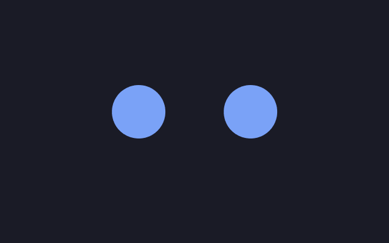
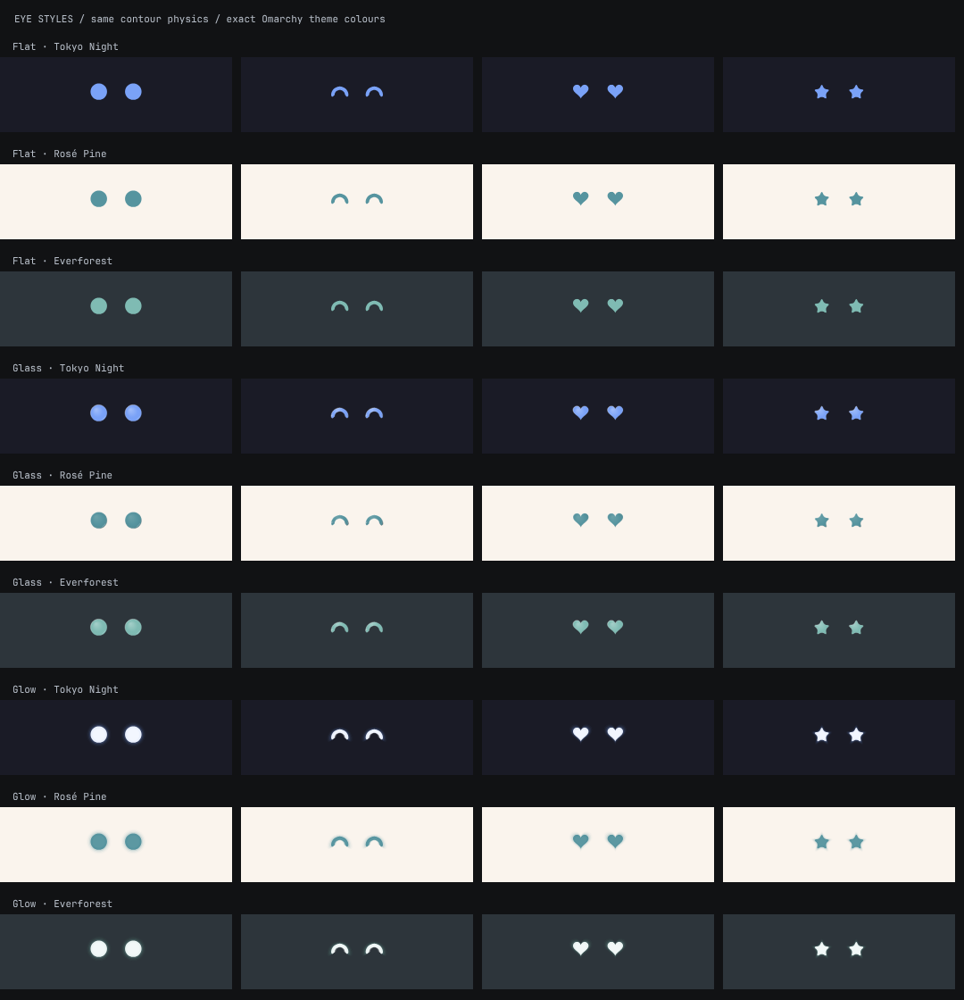
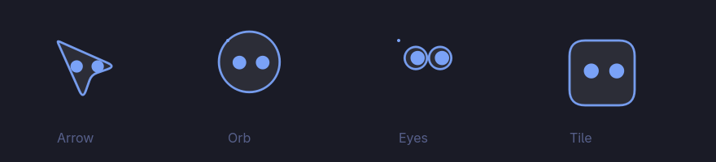
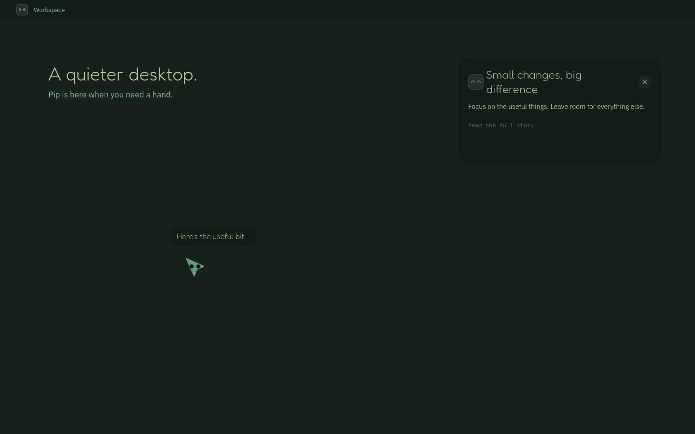

# Pip

<p>
  <a href="https://omarchy.org"></a>
  
  
  
  
  
  <a href="LICENSE"></a>
</p>

Pip is a voice assistant for [Omarchy](https://omarchy.org) that lives on your phone. Put your phone on a stand under your monitor and it shows two eyes in your theme's colours. Talk to it and it can look at your screen, point at things with its own pointer, answer out loud, look things up, take meeting notes, and (if you turn it on) click and type for you.

<p align="center"></p>

<p align="center"></p>

It's an Omarchy shell plugin plus a small web app for the phone. The phone connects to your computer over Tailscale. Your API keys stay on your computer.

Inspired by [bluey-by-riley](https://github.com/rbrown101010/bluey-by-riley) by Riley Brown.

## Install

**1. Install the packages Pip needs:**

```bash
omarchy pkg add bun tesseract tesseract-data-eng wtype grim ffmpeg imagemagick qrencode tailscale python-gobject at-spi2-core
```

**2. Add the plugin:**

```bash
omarchy plugin add https://github.com/baileyrosen3/pip --enable
```

Pip's eyes show up in your bar. Click them to open the menu. If something is missing (a package, input permission, Tailscale), the top of the menu lists it with a button that runs the fix in a terminal so you can see what it does.

**3. Set up your phone:**

- Install Tailscale on the computer if you haven't (`omarchy-install-service-tailscale`) and turn on MagicDNS and HTTPS Certificates in the [Tailscale admin console](https://login.tailscale.com/admin/dns).
- In Pip's menu, press **Set up phone access**.
- On your phone, sign into Tailscale with the same account and open the address shown in the menu (or scan the QR code). Add it to your home screen.

**4. Pick a brain and add a key** (phone settings, or the bar menu):

| Brain | Cost | Key |
|---|---|---|
| Gemini Live (default) | Free tier, with rate limits. Google may use free-tier data. | [aistudio.google.com/apikey](https://aistudio.google.com/apikey), from a project without billing |
| OpenAI Realtime | Paid per use | [platform.openai.com/api-keys](https://platform.openai.com/api-keys) |
| GPT-Live | Paid, $0.05/minute plus tool usage | Same OpenAI key |

Requires Omarchy with Hyprland 0.56+ and Quickshell 0.3+. The phone app is tested on iPhone Safari; Android Chrome should work but is community-tested.

## Using it

On the phone:

| Gesture | Does |
|---|---|
| Double tap | Wake / sleep |
| Press and hold | Ask a question, let go for the answer |
| Tap | Poke the eyes |
| Two-finger tap | Settings |
| Swipe up from the bottom | Past sessions and notes |

On the desktop, use the bar menu, or add these to `~/.config/hypr/bindings.lua` (check they're free first with `omarchy menu keybindings --print`):

```lua
local pipctl = os.getenv("HOME") .. "/.config/omarchy/plugins/blr.pip/bin/pipctl"
o.bind("ALT + SPACE",    "Pip: wake / sleep",        pipctl .. " ctl toggle")
o.bind("CTRL + ALT + P", "Pip: point at mouse",      pipctl .. " ctl point")
o.bind("CTRL + ALT + F", "Pip: follow mouse on/off", pipctl .. " ctl follow")
o.bind("CTRL + ALT + D", "Pip: go home",             pipctl .. " ctl dock")
o.bind("CTRL + ALT + H", "Pip: hide / show",         pipctl .. " ctl hide")
o.bind("CTRL + ALT + S", "Pip: stop using the computer", pipctl .. " ctl stop")
```

### Settings worth knowing

- **Pip answers:** when you talk (default), when you say "Pip", or only when you hold the screen. The last two are better for meetings.
- **Talk out loud:** on by default. Turn it off for text only.
- **Auto-sleep:** Pip goes to sleep after 5 minutes without speech, so a paid brain doesn't keep billing. Can be off, 5, 10 or 30 minutes.
- **Computer control:** off by default. When on, Pip can click, type, press keys, scroll, drag and open apps or links, but only when you ask. It won't press SUPER shortcuts or type into password fields, and it lets go if you move the mouse. `CTRL + ALT + S` stops it.
- **Meeting notes:** off by default. When on, the session audio is recorded on your computer and transcribed with speaker labels into `Pip Notes/`.
- **Look:** colours follow your Omarchy theme. You can change the eye style (Flat, Glass, Glow), eye size, and the desktop pointer (Arrow, Orb, Eyes, Tile).

<p align="center"></p>

<p align="center"></p>

<p align="center"></p>

## Troubleshooting

- **It hears me but doesn't answer.** Check the "Pip answers" setting.
- **The phone can't reach the computer.** Both devices need Tailscale on. Run `pipctl status` (full path: `~/.config/omarchy/plugins/blr.pip/bin/pipctl`) and check that phone access is configured.
- **The mic won't start on iPhone.** Open Pip from the `https://...ts.net:10000` address, allow the microphone, and keep the screen on.
- **Gemini says credits are depleted.** That key's project has billing on. Make a key in a project without billing.
- **Gemini says the free limit is reached.** Wait for it to reset (midnight Pacific) or switch brains.
- **Anything else.** `pipctl status` and the log at `~/.local/state/pip/server.log`. When filing an issue, include both.

## Update or remove

```bash
omarchy plugin update blr.pip
omarchy plugin remove blr.pip
tailscale serve --https=10000 off
```

Removing the plugin leaves your settings in `~/.config/pip` and your notes in `Pip Notes/`.

## Development

See [docs/development.md](docs/development.md).

## License

Public domain ([Unlicense](LICENSE)). Fonts are Fredoka and IBM Plex under the SIL Open Font License.
