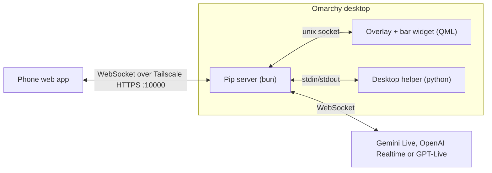

# Development

## Layout

```
manifest.json, Service.qml, Overlay.qml, BarWidget.qml, qml/   Omarchy plugin (Quickshell)
avatar/     eyes, personality, pointers, flight physics (used by both phone and desktop)
server/     bun server: phone WebSocket, brains, tools, OCR, notes, theme, Tailscale, setup checks
agent/      python helper: uinput clicks/scroll, wtype keys, grim capture, AT-SPI focus
web/        phone web app (no build step)
system/     udev rule and modules-load file for /dev/uinput
docs/       design notes, eyes spec, personality catalogue, avatar lab (docs/lab)
bin/pipctl  CLI: serve, key, pair, ctl <cmd>, status
```



The same avatar modules draw the eyes in the phone's browser canvas and in the QML overlay and bar.

## Working from a checkout

```bash
ln -s ~/path/to/pip ~/.config/omarchy/plugins/blr.pip
omarchy plugin enable blr.pip --section right
```

The shell doesn't watch files behind a symlink, so run `omarchy restart shell` after QML changes. Server, phone and avatar changes only need a server restart; the plugin restarts the server if it exits. To tune the eyes, open `docs/lab/` in a browser.

## Tests

```bash
bun test tests/
```

The harness in `tests/harness/` starts a real Pip server on temporary directories and drives it with a scripted phone and fake brains. It never touches your live settings.

## Real-API smoke tests

These cost money (OpenAI) or quota (Gemini) and aren't run in CI. Each starts an isolated server, asks a spoken question and a question about the screen, and expects a spoken, captioned answer.

```bash
export OPENAI_API_KEY=...
bun scripts/smoke-openai.ts
bun scripts/smoke-gptlive.ts
export GEMINI_API_KEY=...
bun scripts/smoke-gemini.ts   # still uses OpenAI to generate the spoken question
```

The screen question uses a fake desktop rendered through the real screenshot and OCR path, so it needs `imagemagick` and `tesseract` with English data.

## Clean install check

GitHub Actions runs `scripts/clean-install.sh` in `archlinux:latest` on every push. It reads the package list from the README's `omarchy pkg add` command (keep exactly one such block), installs it, runs the tests, builds the server, and checks the helper and CLI error messages. Locally:

```bash
docker run --rm --volume "$PWD:/source:ro" --workdir /source archlinux:latest bash scripts/clean-install.sh
```

Add `--from-github` to test a fresh clone of the public repo instead.

## Gemini endpoint

Pip connects to Gemini Live on `v1alpha`. The `v1beta` endpoint rejects `setup.proactivity` (close code 1007), which Pip uses so the "When I say Pip" reply mode can stay quiet. `tests/gemini-schema.test.ts` covers the endpoint and setup together.

## Phone checklist

Before a release, run `scripts/phone-checklist.sh` with a real iPhone. See [phone-checklist.md](phone-checklist.md).
